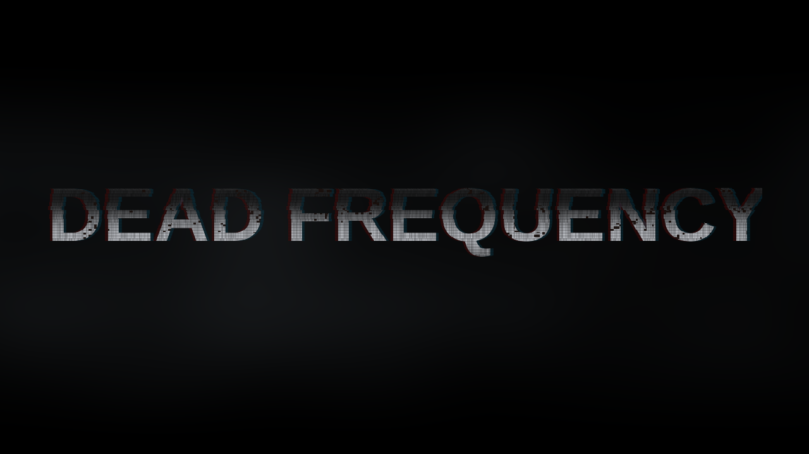

# DEAD FREQUENCY

*A radio that hears the past. Something in the signal that hears you.*

First-person psychological horror for Windows PC. October 17, 1998, 02:43: the HELIX-9 research facility vanishes from every network. In 2026, communications engineer Daniel Arlen is sent to restore its radio — and his hand-held receiver starts picking up the past, the future, and his own voice: *whatever happens, do not open the door.*

**A game developed by YASH AIL.**



## What's in this repository
- A complete, playable campaign in **Godot 3.5**: 2-minute opening cinematic, 13 chapters with optional wings, 4 endings, New Game+ ("Second Signal"), end credits.
- The radio system (four bands plus hidden carriers, directional antenna, battery, exposure), a sound-hunting enemy that learns (and remembers between runs), stealth, puzzles, saves, menus, settings, subtitles, controller support.
- CC0 PBR materials (ambientCG), procedural audio with adaptive music, a voice-over recording package ready for actors.
- 20 production documents in [`docs/`](docs/), an automated test suite that plays the whole campaign, and a built-in `--smoketest` for release builds.

What is **not** done, plainly: the campaign length is a model (3.9–10.1 h main path, 5.4–14.0 h with optional content) until playtests measure it — the 10–15 hour target is not claimed; there is no recorded voice acting (placeholder radio voice + full subtitles); the look is stylised, not photoreal; the Windows build has passed a smoke test under Wine but has **not** been run on real Windows hardware; Steamworks is not integrated. Details: [progress tracker](docs/15_DEVELOPMENT_PROGRESS_TRACKER.md).

## Play from source
1. Install **Godot 3.5.x** (standard build) from godotengine.org, or `sudo apt install godot3` on Ubuntu.
2. Open `game/project.godot` and press **F5**, or run `godot3 --path game` (`--menu` skips the opening).

## Build the Windows release
Install the Godot 3.5.2 export templates, then:
```
tools/package_release.sh --export     # → build/DeadFrequency-<version>-Windows-x64.zip
```
After a fresh clone, `tools/import_assets.sh` imports the textures (the script above does it automatically). Or run the **build** workflow from the GitHub Actions tab (tests, Windows/Linux export, Wine smoke test, release zip).

## Controls
| Action | Keyboard / mouse | Gamepad |
|---|---|---|
| Move / look | WASD / mouse | left / right stick |
| Sprint · crouch · lean | Shift · Ctrl or C · Q / E | L3 · B · LB / RB |
| Interact | F or left click | A |
| Flashlight | T or middle click | Y |
| Radio on/off · tune | R or right click · wheel or ← → | X · D-pad ← → |
| Throw bottle · medkit | G · H | D-pad ↓ · ↑ |
| Journal · pause | Tab · Esc | Back · Start |
| Skip cinematic | hold Space / Enter | hold A |

## Tests
```
tools/test.sh validate   # data integrity: maps, commands, markers, sounds, credits
tools/test.sh flags      # every story flag read is set somewhere
tools/test.sh layout     # no prop blocks a passage
tools/test.sh save       # save/load, damaged-save fallback, ending logic, checkpoints, play-time log
tools/test.sh systems    # movement, flashlight, radio, doors, health, menus
tools/test.sh ai         # the Listener's senses, states and learning
tools/test.sh flow       # intro → menu → new game → focus-loss pause → continue → chapter select → death → reload
tools/test.sh endings    # all four endings + credits
tools/test.sh ngplus     # New Game+ memory, 88.0 content, Listener adaptations
tools/test.sh play       # the full campaign, chapter 1 → ending D
```
Requires `godot3` and `xvfb-run` (`sudo apt install godot3 xvfb`). Latest results: [13_TESTING_PLAN.md](docs/13_TESTING_PLAN.md).

## Documents
| # | Document |
|---|---|
| 01 | [Game Design Document](docs/01_GAME_DESIGN_DOCUMENT.md) |
| 02 | [Story Bible](docs/02_STORY_BIBLE.md) |
| 03 | [Character Bible](docs/03_CHARACTER_BIBLE.md) |
| 04 | [Chapter-by-Chapter Campaign](docs/04_CAMPAIGN.md) |
| 05 | [Mission Design & QA Walkthrough](docs/05_MISSION_DESIGN.md) |
| 06 | [Dialogue & Audio Script](docs/06_DIALOGUE_AND_AUDIO_SCRIPT.md) |
| 07 | [Cinematic Script](docs/07_CINEMATIC_SCRIPT.md) |
| 08 | [Level Design](docs/08_LEVEL_DESIGN.md) |
| 09 | [Enemy AI](docs/09_ENEMY_AI.md) |
| 10 | [Gameplay Systems Architecture](docs/10_GAMEPLAY_SYSTEMS_ARCHITECTURE.md) |
| 11 | [Asset Production List](docs/11_ASSET_PRODUCTION_LIST.md) |
| 12 | [Technical Documentation](docs/12_TECHNICAL_DOCUMENTATION.md) |
| 13 | [Testing Plan & Results](docs/13_TESTING_PLAN.md) |
| 14 | [Release Plan (Steam)](docs/14_RELEASE_PLAN.md) |
| 15 | [Development Progress Tracker](docs/15_DEVELOPMENT_PROGRESS_TRACKER.md) |
| 16 | [Bug Reports](docs/16_BUG_REPORTS.md) |
| 17 | [Campaign Time Budget (model)](docs/17_TIME_BUDGET.md) |
| 18 | [Audio Production Plan & VO](docs/18_AUDIO_PRODUCTION_PLAN.md) — recording script in [`docs/vo/`](docs/vo/) |
| 19 | [Engine Migration Assessment](docs/19_ENGINE_MIGRATION_ASSESSMENT.md) |
| 20 | [Steam Release Package](docs/20_STEAM_RELEASE_PACKAGE.md) |
|  | [Third-Party Notices](docs/THIRD_PARTY_NOTICES.md) · [Privacy](docs/PRIVACY.md) |
|  | [Changelog](CHANGELOG.md) |

Docs 04–08 are generated from the game data (`python3 tools/gen_docs.py <export.json> docs`), so they always match what ships.

## Credits
Developed by **YASH AIL** · Sound Effects by **AJAY GOHIL** · Game Design & Creative Support **ADARSH GUPTA** · Gameplay Testing & Quality Assurance **TANISH SHETTY** · Environment Design & Production Support **SHUBHAM GAONKAR**

Built with Godot Engine (MIT). Fonts: Liberation (SIL Open Font License). Surface textures: ambientCG (CC0). Full notices and licence texts: [`docs/THIRD_PARTY_NOTICES.md`](docs/THIRD_PARTY_NOTICES.md), [`licenses/`](licenses/).
