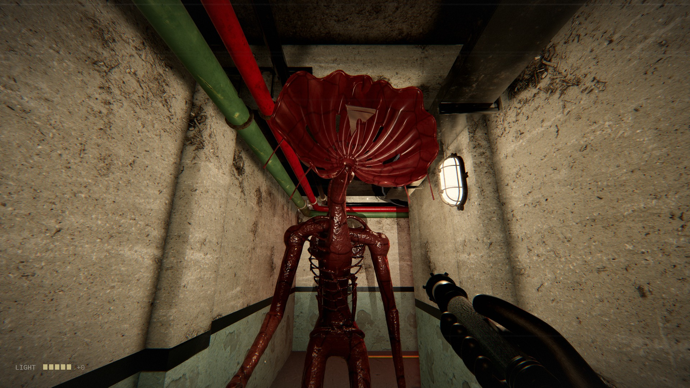

# DEAD FREQUENCY — Visual Audit, 4K Vertical Slice and Approval Package

Status: **the 4K vertical slice is built, playable and documented; it awaits the owner's decision on the visual
standard and on the engine path. No other chapter has been rebuilt.** Date: 2026-11-14.

## 1. Verdict

- **The campaign still looks like a low-budget procedural game**; that criticism stands for all 13 chapters, which are
  unchanged by design until the slice is approved (evidence: `docs/screenshots/01_entrance.png` … `13_the_door.png`).
- **The vertical slice** (Sublevel 3: the service corridor and communications room C3-14) is rebuilt to a new standard and
  now renders natively at **3840 × 2160**. In this pass: a redesigned Listener built to the owner's reference sheet, a red
  emergency corridor with wet floors and decals, 4K surfaces where the frame is filled, a live HX-7 display with a turning
  tuning knob, cinematic depth of field in scripted moments, a full set of graphics settings with five presets, a texture
  quality option, a benchmark mode for real GPUs, a gameplay recording and an isolated Godot 4 benchmark.
- **Honest level:** a clear jump over the campaign, in the range of a competent indie/AA horror game. **It is not
  photorealistic and not AAA.** The creature is a procedural sculpt with code-keyed animation, Godot 3.5 cannot do shadowed
  volumetric fog or real-time GI, and everything was produced on a machine **without a GPU** — so **no frame rate on real
  hardware is known yet**.
- **Engine:** the Godot 4 benchmark (docs/22) renders the same assets with real-time GI, shadowed volumetric fog, real
  decals, TAA and proper skin SSS; it is clearly better on the creature and the atmosphere. **Recommendation: Godot 4 for
  production; UE5 is not needed.** No migration has been started (it needs the owner's approval).

## 2. The approval package — the brief's ten items

| # | Required | What the slice has | Evidence | Still short of the reference |
|---|---|---|---|---|
| 1 | Realistic industrial corridor | 28 m L-shaped service corridor: bevelled concrete (4K surfaces), pilasters, beams, drain channel with grate, pipe runs with flanges, hangers and a valve, cable trays, conduits, junction boxes, steel doors, a vent, red emergency lamps, wet floor with puddles and streaks, leak/rust/grime decals | `s01`, `s03`, `s04`, `s09`, `s13` | Hand-sculpted damage; more variation along the run |
| 2 | Fully detailed communications room | 14 × 10 m room: raised floor with lifted tiles, suspended ceiling with T-bar grid and dead troffers, six racks (receivers, patch panels with cords, reel decks), 8 m operator console with CRTs, main receiver with backlit dial, chart, stopped clock (02:43), papers, cables, CC0 Poly Haven props (25 placed across the slice) | `s05`, `s06`, `s07`, `s11` | Room walls use 1K maps (410 px/m) |
| 3 | Realistic radio and flashlight | Knurled aluminium torch with crenellated bezel and reflector; HX-7 with rubber armour, label, grille, meter, telescopic antenna; **live seven-segment display** (frequency, band, signal bars) and **tuning knob that turns** as you tune; worn leather gloves | `s02`, `s07` | Finger animation on the controls |
| 4 | Completely redesigned Listener | Original creature to the reference: 2.27 m emaciated, asymmetric body, uneven ribcage, long four-joint clawed fingers, translucent veined skin, pleated acoustic membrane head with slits, pores and cartilage rods; 4K skin maps, SSS, transmission, wet clearcoat; 78-bone rig; 3 body LODs | `s10`, `s12`, `creature_*.jpg` | Procedural sculpt (not artist-sculpted); membrane has one LOD |
| 5 | Working creature encounter | Power up the receiver → Evelyn's warning → the lights fail → red beacon → the Listener drops from the vent and searches; hide under the desk and stay silent; real AI, real hiding, checkpoint flow if caught | `s08`, `s14`, the gameplay video; `slice` test 15/0 | — |
| 6 | Cinematic lighting | Baked GI (3 bounces), red emergency light, flickering troffer, rotating beacon, torch hot spot + spill + beam, light shafts, colour grade, **depth of field in scripted moments** | all shots | No shadowed volumetric fog, no real-time GI (Godot 4 has both) |
| 7 | Realistic shadows | Shadowed torch, beacon, troffer and lamp; baked soft shadows elsewhere; shadow atlas up to 8K | `s04`, `s09`, `s10` | Baked fixtures do not shadow moving objects |
| 8 | High-quality materials | PBR with packed AO/roughness/metal and normal maps; 4K/2K Poly Haven and 1K ambientCG surfaces; wet-surface shader; decals; skin SSS | all shots; docs/23 | More 4K sets; true projected decals (Godot 4) |
| 9 | Playable first-person experience | Main menu → *VERTICAL SLICE — VISUAL TARGET*, or `--slice`: walk, torch, radio tuning, transmissions, encounter, hiding | gameplay video; `slice` test | — |
| 10 | Native 4K screenshot evidence | 14 in-game captures at 3840 × 2160 plus creature close-ups at 3840 × 2160 | `docs/screenshots/slice4k/` | — |

## 3. Evidence

**Native 4K.** Every file in `docs/screenshots/slice4k/` is a real-time capture from the game at **3840 × 2160** (window and
3D both at 4K, Ultra preset: 100 % render scale, MSAA 4×, 8K shadow atlas, full textures), saved from the frame buffer by
`tools/test.sh sliceshots DF_RES=3840x2160 DF_SCREEN=3840x2160 DF_PRESET=3`, then stored as JPEG (quality 90) to keep
the repository small. Software rendering (Mesa llvmpipe) produces the same image a GPU would; only the speed differs.
`docs/screenshots/slice/` holds the same views downscaled to 1920 × 1080 for reading.

| View | Shows |
|---|---|
| `s01_corridor` | The service corridor from the stairwell door: 4K concrete, pipes, drain grate, wet floor |
| `s02_receiver` | First person: the HX-7 on 101.3 FORECAST, gloved hands, torch |
| `s03_corner` | The corner under the torch: hot spot and spill, signage |
| `s04_listener_corridor` | The Listener in the red emergency corridor, lit by the torch |
| `s05_vestibule` | The C3-14 doorway: hazard frame, red light, RF warning |
| `s06_room` | The communications room from the door |
| `s07_console` | The main receiver with the HX-7 on 89.1 — the reference's "gloved hand, 89.1 MHz" moment |
| `s08_encounter` | Under the desk while the Listener listens — "Under the Desk" |
| `s09_hunt` | The Listener running at the player — "Hunting" |
| `s10_creature_close` | The Listener fully lit by the torch at 2 m — "Listening" |
| `s11_creature_room` | The Listener searching the room — "Searching" |
| `s12_head_close` | The membrane head from below at about 1 m |
| `s13_crawl` | The Listener crawling near the vent — "Crawling" |
| `s14_search_hidden` | Seen from under the desk while the Listener searches the room |
| `creature_front`, `creature_q34`, `creature_head` | The creature under neutral studio light (key + rim), 3840 × 2160, nothing hidden by darkness |

Also in `docs/screenshots/slice/`: `compare_corridor.jpg` and `compare_room.jpg` (the campaign's look on the left, the slice on the right) and `creature_turntable.jpg` (front, three-quarter, side and back under studio light).

**Gameplay recording:** `docs/media/slice_gameplay.mp4` — 1280 × 720, 30 fps, silent (the cloud machine has no audio
device). It is real gameplay driven by a scripted controller (`tools/record_slice.sh` → test mode `slicerec`): the
player walks with the movement actions, raises and tunes the HX-7, receives the forecast, powers up the receiver,
the encounter script runs, and the real Listener AI searches while the player hides. Each frame is exactly 1/30 s of
game time (`--fixed-fps 30`), so it plays at true speed although the machine rendered it far slower.

**Godot 4 comparison:** `docs/screenshots/g4/` and docs/22.

## 4. Graphics settings (Section 8 of the brief)

Presets **Low, Medium, High, Ultra, Cinematic**; window resolution up to **3840 × 2160**; **render scale** 50–150 %
(the 3D world renders in its own viewport, the UI stays sharp); **texture quality** Full/Half; **shadow quality**
(atlas 1K–8K); **reflections** (off / screen-space / high); **ambient occlusion** (off / low / high); **anti-aliasing**
(off / FXAA / MSAA 2×, 4×, 8×); **view distance** (45–200 m); **V-Sync**; **frame-rate limit** (30 / 60 / 120 / 144 /
unlimited). Full table: docs/12, *Graphics settings*.

## 5. Hardware and performance

**Measured here:** this machine has **no GPU** — 4 CPU cores, 15 GB RAM, Mesa llvmpipe (software OpenGL). The slice
runs at 1.3–1.7 fps at 1280 × 720 on every preset (`tools/test.sh sliceperf`: 1.6–2.3 million vertices, 260–300 draw
calls, ~250 MB video memory per frame); a 4K frame takes several seconds. These numbers describe the scene's cost
profile only. **No frame rate on gaming hardware is claimed.**

**To measure on a real GPU:** run `DeadFrequency.exe --benchmark` (and `--benchmark --4k`) on the target PC. It flies the
slice along a fixed path with the torch on and the Listener in the room, runs each preset for 24 s with V-Sync and the
limiter off, and writes `benchmark.txt` (GPU name and driver, 3D resolution, average fps, 1 % low, worst frame) to
`%APPDATA%\Godot\app_userdata\DEAD FREQUENCY\`. Sending that file back gives the first real measurements.

Expected hot spots (from the profile, to check against GPU numbers): the raised-floor tiles and grate bars (thousands of
small bevelled boxes), the membrane's 86k triangles at every distance, per-light passes in Godot 3's forward renderer,
MSAA at 4K.

## 6. Assets and textures

docs/23 lists every asset of the slice with triangle counts, texture sizes, texel density per surface, the creature's
LODs, maps, rig and animations, and the licences. Everything is original (generated by the project's Blender and Godot
scripts) or CC0 (Poly Haven, ambientCG); nothing was purchased.

## 7. Audit against the earlier fifteen required changes (updated)

| # | Change | Campaign | Slice now | Still needed |
|---|---|---|---|---|
| 1 | Detailed environments | Grid quads | Authored corridor and room (§2 items 1–2) | Modular kits for 12 more areas |
| 2 | PBR materials | 1K CC0, triplanar | 4K/2K/1K PBR, wet shader, decals | More 4K sets; layered grime shaders |
| 3 | Concrete, metal, glass, water, damage | Flat tints | Stained concrete, rust, wired glass, puddles, wet streaks, leaks | Water flow, broken glass |
| 4 | Lighting and shadows | Few lights | Baked GI + shadowed dynamic lights | Real-time GI (Godot 4) |
| 5 | Volumetric fog | Depth fog | Depth fog + light shafts | Shadowed volumetric fog (Godot 4) |
| 6 | Reflections | SSR (Ultra) | Probes + SSR on wet floors and glass | — |
| 7 | Research facility identity | Generic | 1998 sublevel: signage, chart, racks, consoles, CRTs, clock | Same for 12 areas |
| 8 | Detailed creature | Primitives | Listener v2 (§2 item 4) | Artist sculpt, polished animation |
| 9 | Hands, torch, radio | Boxes | Modelled; live display; turning knob | Finger animation |
| 10 | Animation, interactions | Code-swung | 7 creature animations; hand sway, bob, click, tilt | Full first-person animation set |
| 11 | Main menu | 3D exterior | Unchanged | After approval |
| 12 | UI, typography | Functional | The HX-7 is the radio UI in the slice | After approval |
| 13 | Cinematic camera, grading | Basic | Grade; depth of field in scripted moments | Cinematics rebuilt after approval |
| 14 | Rain, water, particles | Basic | Steam, drips, dust, puddles | Exterior rain |
| 15 | Optimise | — | Baked light, merged meshes, creature LODs, texture quality, render scale, benchmark mode | GPU measurements |

## 8. Decisions for the owner

1. **Approve or redirect** the slice as the visual standard.
2. **Engine path:** stay on Godot 3.5, port to Godot 4 (recommended, docs/22), or UE5.
3. **Run `DeadFrequency.exe --benchmark`** on the target PC and send `benchmark.txt`.
4. **Art staffing** for what code cannot reach: a character artist/animator (creature, hands), an environment artist.
5. Only after approval: the remaining 12 areas, the main menu, UI and all cinematics.

**Rebuild pipeline (reproducible):** `tools/fetch_polyhaven.py` → `tools/write_texture_imports.py` → Blender scripts
(`blender -b --factory-startup --python tools/blender/<script>.py -- <out>`; the creature: `listener_v2.py`) →
`tools/import_assets.sh` → `godot3 --path game -s res://slice/build_slice.gd` →
`DF_BAKE=res://slice/Slice.tscn godot3 --path game --editor` (bakes through `addons/df_tools`).
