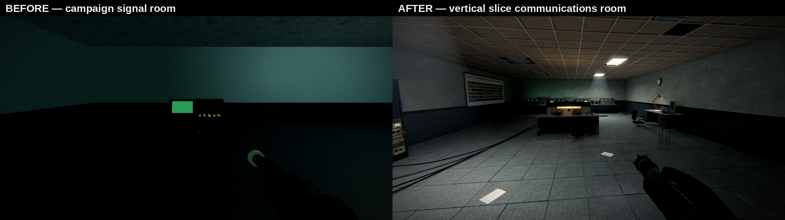

# DEAD FREQUENCY — Visual Audit, Engine Decision and Vertical Slice

Status: **vertical slice built and playable; awaiting the owner's approval of the visual standard and of the engine path before any other chapter is rebuilt.** Date: 2026-11-14.

## 1. Verdict in one page

- **The shipped campaign looks like a low-budget retro title — the criticism is correct.** Every level is built at runtime from an ASCII grid: walls, floors and ceilings are flat quads on a 2 m grid, props are primitive boxes and cylinders, characters are capsule rigs, the creature is a stack of primitives, and lighting is a handful of dynamic lights with a flat ambient term. CC0 textures (added earlier) improved surfaces but cannot hide primitive geometry and flat light. Evidence: `docs/screenshots/01_entrance.png` … `13_the_door.png`.
- **A vertical slice now exists** (Sublevel 3: an L-shaped service corridor and communications room C3-14, about 28 m of corridor and a 14 × 10 m room). It is rebuilt to a new standard with authored, bevelled geometry, photoscanned CC0 props and 2K PBR surfaces, baked global illumination, reflection probes, light shafts, wet floors, steam and drips, a colour grade, modelled first-person hands, torch and receiver, and a new rigged and animated creature. It is playable (main menu → *VERTICAL SLICE — VISUAL TARGET*, or `--slice`) and has an automated test (13 checks). Evidence: `docs/screenshots/slice/`.
- **What it is, honestly:** a clear jump from the campaign — it reads as a modern, lit, believable industrial interior in the range of a competent indie / AA horror game. **It is not AAA photorealism**, and no claim of that is made: there is no real-time global illumination or shadowed volumetric fog, no temporal anti-aliasing, no decals, the creature and hands are procedural sculpts with code-keyed animation (no motion capture, no hand-sculpted detail), and everything was produced and verified on a machine **without a GPU** (software rendering).
- **Engine decision:** Godot 3.5 has reached its practical ceiling with this slice. **Recommendation: migrate to Godot 4.x (Forward+)** for the production of all chapters; choose **Unreal Engine 5** only if the owner can provide GPU workstations, art staff and the time for a full systems rebuild. Either migration needs the owner's approval (§4). Everything built for the slice — Blender scripts, glTF models, textures, the scene layout, the gameplay data — carries over to either engine.

## 2. Audit of the current visuals against the 15 required changes

| # | Required change | Campaign today | Slice | Still missing / needs |
|---|---|---|---|---|
| 1 | Detailed 3D environments | Grid quads, auto pipes | Authored corridor and room: pilasters, beams, drain channel with grate, pipe runs with flanges/hangers/valve, cable trays with cables, conduits, junction boxes, doors with frames/hinges/wired glass, raised floor with lifted tiles, suspended ceiling with T-bar grid, troffers and missing tiles, hazard-striped blast-door frame | A modular kit for all 13 chapters; hand-sculpted damage; artist passes |
| 2 | Realistic PBR materials | 1K CC0 sets, triplanar | 2K Poly Haven surfaces + ambientCG, albedo/normal/AO-roughness-metal, real-world texel scale, painted bands over concrete | Layered grime/edge-wear shaders, decals (Godot 4) |
| 3 | Concrete, metal, glass, water, damage | Flat tints | Stained concrete, rusted and painted steel, galvanised trays, wired glass, CRT glass, reflective puddles, peeling paint | Water flow, broken glass, dirt decals |
| 4 | Dynamic lighting and shadows | Few omni lights, flat ambient | Baked GI lightmap (3 bounces, denoised), static + dynamic lights, torch with hot-spot + spill and real-time shadows, flickering lights, rotating beacon | Real-time GI for the torch's bounce light (SDFGI/Lumen) |
| 5 | Volumetric fog, depth | Depth fog | Depth fog + soft light shafts (depth-faded, drifting dust) + a beam on the torch | True froxel volumetric fog with light shadows (Godot 4 / UE5) |
| 6 | Reflections, detail | SSR on Ultra only | Box-projected reflection probes + SSR on wet floor and glass | Screen-space + probe blending artefacts remain; ray-traced reflections need UE5/RT |
| 7 | Industrial research facility | Generic boxes | Recognisable 1990s sublevel: signage, frequency chart, racks with reel decks and patch cords, operator consoles, CRT logs, stopped clock at 02:43 | Same standard for 12 other areas |
| 8 | Detailed creature | Primitive stack | Original creature: 2.6 m, voxel-sculpted body with ribs, vertebrae, scapulae, skull; forward-facing membrane "ear" with cartilage spokes and a tooth pit; 63k-tri game mesh, baked normal/AO/skin maps; 42-bone rig; idle, walk, run, listen, attack | Artist sculpt, hand-painted textures, motion-captured or hand-keyed animation, IK foot placement |
| 9 | Hands, torch, radio | Boxes | Gloved hands (sculpted grip), knurled aluminium torch with crenellated bezel and reflector, HX-7 receiver with live frequency display, band name, signal bars, knobs, telescopic antenna | Rigged hands with finger animation (tuning, switching) |
| 10 | Animations, interactions | Code-swung primitives | Creature animation set blended by AI state; hand sway/bob/raise retained | Full first-person animation set; door/console interactions |
| 11 | Premium main menu | 3D exterior + list | Unchanged (pending approval) | Menu staged in the new art (e.g. the slice corridor), new typography |
| 12 | UI, typography, chapter titles | Functional | Receiver is the radio UI (HUD panel hidden in the slice); new card label | Type system and motion design pass |
| 13 | Cinematic camera, grading | Basic | Film-style grade (split toning, contrast, grain, vignette, slight chromatic aberration) | Physically based camera (DOF, exposure) in cinematics; Godot 4 / UE5 tools |
| 14 | Rain, water, particles | Basic particles | Steam from the valve, ceiling drips, wet puddles, dust | Rain/water for the exterior chapters; GPU particle collisions |
| 15 | Optimise for modern PCs | — | Baked lighting (cheap at runtime), merged static meshes, lightmap capture for moving objects | Measured on GPUs; LOD (none in Godot 3), occlusion (rooms & portals) |

## 3. Engine capability comparison

| Capability | Godot 3.5 (GLES3) — current | Godot 4.x (Forward+, Vulkan/D3D12) | Unreal Engine 5 |
|---|---|---|---|
| Global illumination | Baked lightmaps (CPU), GIProbe (voxel, leaky) | LightmapGI (GPU), VoxelGI, **SDFGI** (real-time, large scenes), SSIL | **Lumen** (real-time GI + reflections) |
| Volumetric fog | None (faked with shafts) | **Froxel volumetric fog with light shadows**, fog volumes | Volumetric fog, heterogeneous volumes |
| Shadows | Shadow maps (PCF) | Shadow maps with soft (PCSS-style) filtering | **Virtual shadow maps** |
| Anti-aliasing | MSAA, FXAA | MSAA, FXAA, **TAA, FSR 2** | TSR, DLSS/FSR plug-ins |
| Decals / light cookies | No / no | **Yes / yes** | Yes / yes |
| Geometry budget | No automatic LOD | **Automatic mesh LOD**, occlusion culling, HLOD ranges | **Nanite** (film-quality meshes) |
| Characters | Skeletons, blend trees | Skeletons, IK, retargeting | MetaHuman, Control Rig, motion matching |
| Cost / licence | MIT, free | MIT, free | Royalty-bearing above a revenue threshold (check current Epic EULA) |
| Port effort from today | — | Moderate: GDScript 3 → 4 conversion of ~4,500 lines + data | Full rebuild of every system in C++/Blueprints |
| Runs in this development environment | Yes (software GL) | **Not without approval** (downloading and running an engine binary was blocked here; needs Vulkan — software Vulkan possible but very slow) | **No** (no GPU, ~100 GB install, Epic account) |

**Conclusion.** The slice shows the ceiling of Godot 3.5: further gains in realism now depend on features 3.5 does not have (volumetric fog with shadows, real-time GI for a moving torch, TAA, decals, LOD) and, above all, on art production. Godot 4 provides most of the missing rendering features while keeping the existing code and data portable; UE5 provides the highest ceiling (Lumen, Nanite, MetaHuman) at the cost of a full rebuild and much higher hardware and staffing requirements.

## 4. Migration plan (needs owner approval before it starts)

**Recommended: Godot 4.x (latest stable 4.x at the time of starting).**

1. **Branch and freeze** — work on a separate branch; the Godot 3.5 build stays shippable and testable (rollback = keep releasing 3.5).
2. **Port the code** (estimate 1–3 weeks for one experienced developer; an estimate, not a measurement): run Godot 4's 3→4 project converter, then fix by hand: `yield` → `await`, `Spatial` → `Node3D`, Tween/signal APIs, `ShaderMaterial` code (GLSL changes), UI theme, audio buses. Bring every test suite back to green (validate, flags, layout, save, systems, ai, flow, endings, ngplus, play, slice).
3. **Re-light the slice in Godot 4**: LightmapGI or SDFGI, volumetric fog with shadowed light shafts, decals for grime/signage, TAA/FSR 2, physical light units; compare side by side with this slice; owner signs off the look.
4. **Production**: a modular environment kit derived from the slice (walls, doors, pipes, trays, ceilings per department), chapter by chapter, keeping the gameplay grid and data files; characters and animation by artists (or licensed assets, each checked for licence).
5. **Windows performance targets** measured on real GPUs at each milestone (target 60 fps at 1080p High on a GTX 1060/RX 580-class GPU, Low preset playable on integrated graphics).

**Risks:** port regressions (mitigated by the automated suites); Godot 4 renderer bugs/driver issues on older GPUs (keep a Compatibility-renderer fallback); asset production is the real bottleneck in any engine; schedule.
**UE5 alternative:** only with GPU hardware, Epic account, artists, and acceptance of a rebuild measured in months; reuse the story data, dialogue, mission structure, test scenarios, Blender assets (glTF/FBX) and CC0 sources.

**Blocked here, needs the owner:** running Godot 4 or UE5 in this environment (downloading/executing an engine binary was blocked by the environment's safety policy; there is no GPU). The owner can allow a Godot 4 download and execution, or run the port on their own machine.

## 5. The vertical slice

**Play:** main menu → *VERTICAL SLICE — VISUAL TARGET*, or `DeadFrequency.exe --slice` / `godot3 --path game -- --slice`. Walk the corridor (a 101.3 MHz forecast in your own voice, an 89.1 MHz echo from 1998), enter C3-14, power up the main receiver (Evelyn Voss's 1998 warning), then the lights fail, a red beacon starts, and the Listener comes down the vent and into the room. Hide under the desk by the south wall and stay silent; if you are found, it is the usual checkpoint flow. The slice never touches the campaign save.

**What is in the scene:**
- Architecture (`tools/blender/slice_shell.py`): bevelled walls with painted lower band, pilasters and beams every 4 m, drain channel with a 300-bar grate, pipe runs with flanges, hangers and a hand-wheel valve, cable trays with sagging cables and a slipped loop, conduits and junction boxes, three steel doors, a vent hole, the comms door frame with hazard striping and an opened blast door, a 0.6 m raised floor with lifted tiles and cables beneath, and a suspended ceiling with T-bar grid, troffers (three working), missing and hanging tiles.
- Dressing (`tools/blender/slice_dress.py`): six equipment racks (receivers, patch panels with cords, meter panels, switch panels, reel-to-reel decks), an 8 m operator console with a sloped instrument panel, three CRT monitors with live-looking logs and a waveform, keyboards, the main receiver island with an amber backlit dial and knobs, chairs (one knocked over), a frequency-allocation chart ("NOT OURS" circled on 107.9), a wall clock stopped at 02:43, signage, papers and floor cables.
- CC0 props (Poly Haven): field radio transceiver, instrument panel, office desk, laptop, desk lamp, cassette player, multimeter, cabinets, racks, extinguishers, fire alarms, power and utility boxes, bulkhead and fluorescent lamps, a caged hanging lamp, security camera, wet-floor sign, bins, boxes, toolboxes, gas mask (27 models).
- Lighting and atmosphere (`game/slice/build_slice.gd`): baked lightmap (CPU lightmapper, 3 bounces, denoised, 16 texels/m), lightmap capture for moving objects, three box-projected reflection probes, dynamic flickering lights, the beacon, light shafts, puddles, steam, drips, a colour grade.
- First person (`tools/blender/fp_items.py`, `scripts/fp_models.gd`): gloved hands, knurled torch, HX-7 receiver whose display renders the live frequency, band and signal.
- Creature (`tools/blender/listener.py`, `scripts/listener_model.gd`): see §2 row 8; driven by the existing eight-state AI.

**Rebuild pipeline (reproducible):** `tools/fetch_polyhaven.py` → `tools/write_texture_imports.py` → Blender scripts (`blender -b --factory-startup --python tools/blender/<script>.py -- <out>`) → `tools/import_assets.sh` → `godot3 --path game -s res://slice/build_slice.gd` → `DF_BAKE=res://slice/Slice.tscn godot3 --path game --editor` (bakes through `addons/df_tools`).

## 6. Evidence

All `s0*` images are real-time captures from the game (Godot 3.5.2, Ultra preset, 1920 × 1080, software rendering, saved as JPEG quality 92); produced with `tools/test.sh sliceshots`. Comparisons put the campaign gallery image (left) next to the slice capture (right).

| File | Shows |
|---|---|
| `docs/screenshots/slice/s01_corridor.jpg` | Service corridor from the stairwell door: baked light, bulkhead lamps, pipes, drain grate, wet-floor sign |
| `s02_receiver.jpg` | The HX-7 in hand on 101.3 (live display), torch, storage door, puddle |
| `s03_corner.jpg` | The corner: soft torch hot spot and spill, signage |
| `s04_listener_corridor.jpg` | The Listener in the corridor under the torch |
| `s05_vestibule.jpg` | The C3-14 doorway: hazard frame, red light, RF warning |
| `s06_room.jpg` | The communications room from the door |
| `s07_console.jpg` | The main receiver: amber dial, CC0 field radio, headphones, HX-7 on 89.1 |
| `s08_encounter.jpg` | Hiding under the desk while the Listener searches; red beacon |
| `s09_hunt.jpg` | The Listener running at the player |
| `compare_corridor.jpg`, `compare_room.jpg` | Campaign (left) vs slice (right) |
| `creature_turntable.jpg`, `viewmodel.jpg` | Creature (neutral studio light) and first-person models (test room) |

## 7. Performance (measured here — software rendering only)

`tools/test.sh sliceperf`, 1280 × 720, Mesa llvmpipe on 4 CPU cores (**no GPU**): 1.3–1.7 fps on every preset; 1.6–2.3 million vertices, 260–300 draw calls and ~251 MB video memory per frame (vertex count includes shadow and per-light passes). This only shows the scene's cost profile; it says nothing about frame rate on a real GPU, which **has not been measured**. Expected hot spots to optimise before production: the raised-floor tiles and grate bars (thousands of small bevelled boxes), knob/LED cylinders, per-light passes in Godot 3's forward renderer (merge lights, prefer baked), and the absence of LOD in Godot 3.

## 8. What happens next (owner decisions)

1. **Approve or redirect the visual standard** of the slice (it is the bar for every chapter).
2. **Choose the engine path:** stay on Godot 3.5 (ship sooner, this ceiling), migrate to Godot 4 (recommended), or UE5 (highest ceiling, largest cost). If Godot 4 or UE5: allow the engine download/execution in this environment, or run it on your machine.
3. **Art staffing:** at least a character artist/animator for the creature, hands and humans; an environment artist for the modular kits; the slice pipeline lets one technical artist produce a lot of the environment procedurally.
4. Only after approval: rebuild the remaining 12 areas, the main menu and UI to this standard.
