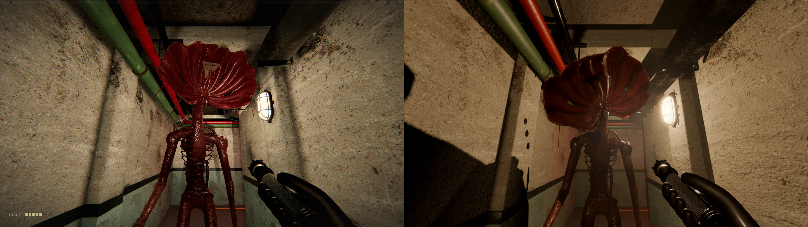

# DEAD FREQUENCY — Godot 4 Isolated Visual Benchmark and Engine Evaluation

Date: 2026-11-14. Status: **benchmark built and rendered; no migration started.** The Godot 3.5 game is untouched by
the benchmark and remains the shipping build and the backup.



## 1. What was built

`benchmark_godot4/` is a separate Godot 4.7.2 project (Forward+ renderer). It shares no files with `game/` at run time and
contains no gameplay. One script, `bench.gd`, rebuilds the vertical slice from **the same source files** the 3.5 game uses:

- the Blender exports of the corridor and room (`slice_shell.gltf`, `slice_dress.gltf`), the 25 Poly Haven props with the
  placement table copied from `game/slice/build_slice.gd`, the same surface table (texture, tint, tiling, roughness, metal,
  normal strength) and the same light list;
- the Listener v2 (`listener2.gltf`, 4K skin maps), the first-person torch, HX-7 and gloves with the material values of
  `game/scripts/fp_models.gd`;
- the wet-floor shader, ported to Godot 4 syntax (`wet_surface4.gdshader`, same inputs and behaviour).

Godot 4 features switched on: **SDFGI** real-time global illumination (4 cascades, occlusion), SSIL, SSAO, SSR,
**shadowed volumetric fog** (every light casts shadows into the fog), **projected decals** (21: leaks, rust, grime,
the creature's smear, puddles), AgX tone mapping, glow, **TAA** with 2× MSAA, ORM-packed materials, **subsurface
scattering with transmittance** on the creature's skin and membrane, and a **projector texture** on the torch (hot core,
ring, faint spill).

Not carried over (deliberately, it is a rendering test): gameplay, the 3.5 colour grade (grain, vignette, chromatic
aberration), the baked lightmap (the benchmark is fully dynamic, nothing is baked), reflection probes, steam and drip
particles. Asset copies: the 3.5 files were copied in (Git stores identical files once); the two surfaces raised to 4K
for the 4K pass are still 2K in the benchmark, which is what its images show.

Run it (any machine with Vulkan; here it ran on Mesa lavapipe, software Vulkan, no GPU):

```
godot4 --path benchmark_godot4 --headless --import          # first time only
DF_OUT=/some/folder godot4 --path benchmark_godot4 --resolution 1920x1080 -s res://bench.gd
```

## 2. Evidence

All images are renders of the same viewpoints, 1920 × 1080. Left: the Godot 3.5 game (downscaled from its native
3840 × 2160 capture, Ultra preset, in-game colour grade). Right: the Godot 4 benchmark (40 frames per view so TAA and
SDFGI settle; no colour grade). Files: `docs/screenshots/g4/`.

| File | What it shows |
|---|---|
| `compare_s10_creature_close.jpg` | The Listener under the torch. Godot 4: the creature's shadow is thrown across the wall by the torch, the membrane reads as thin tissue (SSS + transmittance), the skin loses the plastic look. 3.5: the creature is lit evenly by the baked-light capture; only the torch's spill shadows. |
| `compare_s04_listener_corridor.jpg` | The red emergency corridor. Godot 4: the red light scatters in shadowed volumetric fog and the creature becomes a silhouette in it — the mood of the reference's "red-lit wet corridor". 3.5: clearer and flatter. |
| `compare_s07_console.jpg` | The main receiver and the HX-7 on 89.1. Godot 4: the dial's warm light falls on the desk and props in real time, the CRT glow reaches the back wall. |
| `compare_s06_room.jpg` | The communications room. **Here 3.5 is better:** its 3-bounce baked lightmap lights the suspended ceiling and walls; SDFGI alone leaves the ceiling black. Godot 4 would use LightmapGI (its own GPU bake) for this, not SDFGI. |
| `g4_s01_corridor.jpg`, `g4_s11_creature_room.jpg` | Further views. s11 shows an artefact: a dark ring in the volumetric fog above the creature (not investigated; a tuning item). |

## 3. Evaluation

| Criterion | Godot 3.5 (the game today) | Godot 4.7 (benchmark) | Unreal Engine 5 (not run here) |
|---|---|---|---|
| Rendering quality | Good PBR; reaches its ceiling in the slice | Clearly better in the creature and atmosphere shots; worse in the room until it gets a lightmap bake | Highest ceiling (Lumen, Nanite, virtual shadow maps) |
| Lighting | Baked GI (CPU) + few real-time shadowed lights; no shadowed fog | Real-time GI (SDFGI), every light shadowed and in the fog; LightmapGI available for static rooms | Lumen real-time GI and reflections |
| Materials | SpatialMaterial, SSS and transmission are approximate; decals faked with quads | ORM materials, screen-space SSS with transmittance, real projected decals, light projectors | Substrate/layered materials, MetaHuman skin |
| Creature | Holds up in silhouette; looks evenly lit and plastic under some lights | Reads as wet, thin-skinned tissue under the torch; shadows sell its size | Same assets would look best; motion matching, Control Rig |
| Performance | Measured here on software OpenGL only (1.3–1.7 fps at 720p, every preset). **No GPU measurement.** | Software Vulkan only: 1.2–1.9 s per 1080p frame for this scene. **No GPU measurement.** Forward+ needs a Vulkan/D3D12-class GPU; heavier than 3.5 per frame | Not measured; highest hardware floor |
| Asset compatibility | — | **Every asset loaded unchanged**: 239 files imported with 0 errors (glTF, JPEG/PNG maps, rigged and animated creature). Materials were recreated in code with the same values; one shader ported by renaming built-ins and hints (`WORLD_MATRIX`→`MODEL_MATRIX`, `NORMALMAP`→`NORMAL_MAP`, `hint_albedo`/`hint_color`→`source_color`, `hint_white`→`hint_default_white`) | glTF/FBX import works; every material and shader rebuilt |
| Development cost | Free (MIT) | Free (MIT) | Free to start; royalty-bearing above a revenue threshold (check the current Epic EULA); larger hardware and staff needs |
| Migration effort | — | Port ~4,500 lines of GDScript + data (`yield`→`await`, node renames, Tween/File APIs, 6 shaders); estimate 2–4 weeks for one developer plus re-lighting the slice (an estimate, not a measurement) | A rewrite of every system in C++/Blueprints; months |

## 4. Recommendation

1. **Godot 4 is sufficient for the reference's standard; UE5 is not needed.** The benchmark shows the rendering features
   that the 3.5 slice lacked (shadowed volumetric fog, real-time shadows from every light onto the creature, real decals,
   proper SSS, TAA) working on our existing assets with no conversion. What still separates the slice from the reference
   is art — hand-sculpted creature detail, animator-quality motion, more 4K surfaces — which is the same work in any engine.
2. If approved, port on a separate branch (plan in `docs/19_ENGINE_MIGRATION_ASSESSMENT.md`), keep the Godot 3.5 build
   releasable as the backup, light static rooms with **LightmapGI** and use SDFGI/volumetric fog for the torch and the
   creature, and re-shoot every slice view side by side before any chapter is rebuilt.
3. Before choosing, **measure on a real GPU**: `DeadFrequency.exe --benchmark` (3.5 game) on the target PC; the Godot 4
   benchmark scene can be opened in the Godot 4 editor on the same PC for a frame-time reading.

**Needs the owner:** approval of the engine path (stay on 3.5 / port to Godot 4 / UE5) — a major engine migration is
not started without it.
